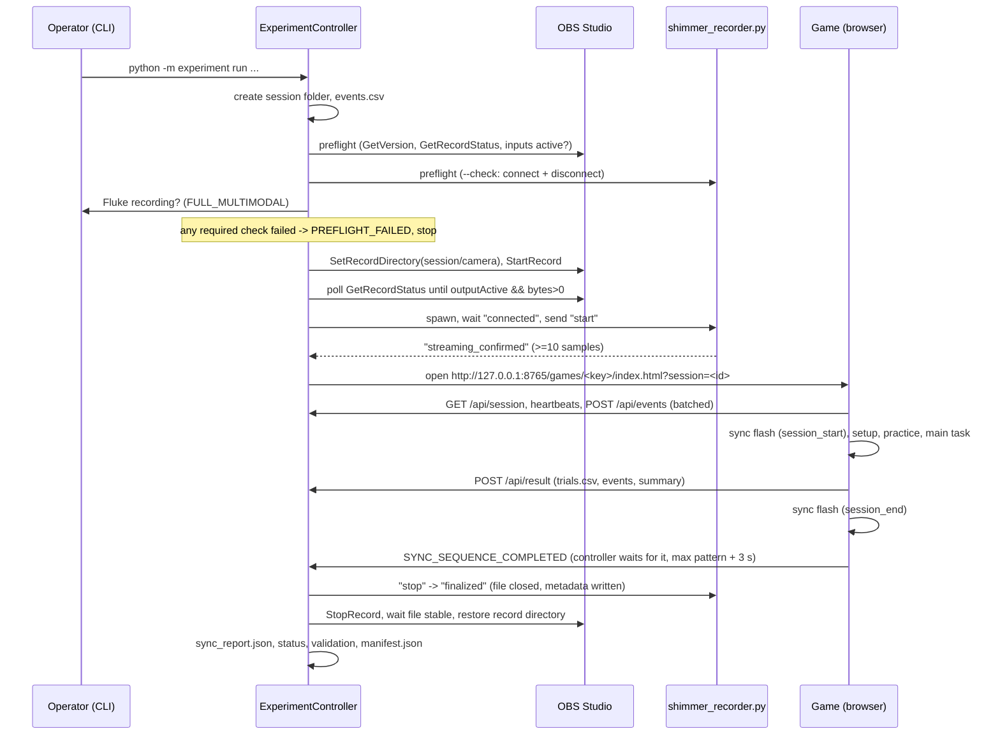

# Architecture

How the pieces fit together after integration. For what existed before, see
[CODEBASE_AUDIT.md](CODEBASE_AUDIT.md); for file contents, see [DATA_FORMATS.md](DATA_FORMATS.md).

## 1. Layout

```text
BTP_2026/
├── experiment/                 NEW  Python controller package (stdlib only)
│   ├── cli.py                       `python -m experiment ...` operator commands
│   ├── controller.py                ExperimentController: session life cycle
│   ├── session.py                   SessionManager, metadata.json, status values
│   ├── events.py                    EventLogger -> events.csv
│   ├── server.py                    local HTTP server (games + API) on 127.0.0.1:8765
│   ├── sync.py                      SyncManager -> sync_report.json
│   ├── validation.py                validate_session(), manifest.json
│   ├── postprocess.py               runs hd_camera scripts on the session video
│   ├── modes.py / config.py / clock.py
│   └── adapters/
│       ├── base.py                  AcquisitionAdapter contract, CheckResult
│       ├── obs_camera.py            OBS-WebSocket v5 client + camera adapter
│       ├── ws_client.py             minimal WebSocket client
│       ├── shimmer.py               drives Shimmer/shimmer_recorder.py subprocess
│       ├── game.py                  game build check + browser launch
│       └── mock.py                  MockCameraAdapter (records nothing)
├── config/experiment_config.toml NEW  all settings (+ optional *.local.toml per machine)
├── Shimmer/
│   ├── test_shimmer.py         MODIFIED  original 30 s baseline, now uses shimmer_api.py
│   ├── shimmer_api.py          NEW  pythonnet/ShimmerAPI loader, device wrapper, simulator
│   └── shimmer_recorder.py     NEW  session recorder (all channels, metadata, JSON-lines protocol)
├── hd_camera/scripts/
│   ├── extract_landmarks.py    MODIFIED  CLI args (defaults = old paths), --max-frames
│   ├── calculate_features.py   MODIFIED  CLI args (defaults = old paths)
│   └── detect_sync_marker.py   NEW  finds the sync flash in a video, aligns with events.csv
├── Games/NO-GO, Games/ODD-ONE-OUT
│   ├── src/integration/        NEW  sessionBridge.ts, SyncFlash.tsx, OrchestratorBanner.tsx (identical in both)
│   ├── src/App.tsx             MODIFIED  bridge wiring (inactive without ?session=)
│   └── vite.config.ts          MODIFIED  base: './'
├── tests/                      NEW  Python unittest suite (60 tests)
└── docs/                       NEW
```

The game folders keep their names and repositories; NO-GO is its own git
repository and builds stand-alone. Nothing was moved or deleted; raw data in
`hd_camera/videos`, `hd_camera/features` and the model file are untouched.

## 2. Who owns what

| Responsibility | Owner | Notes |
|---|---|---|
| Session folder, metadata, status | `SessionManager` / `ExperimentController` | one folder per run, never reused |
| Central event log | `EventLogger` | controller events + every game event + recorder messages |
| OBS recording start/stop | `OBSCameraAdapter` (controller) | browser `obsController.ts` is only used by ODD-ONE-OUT when run stand-alone |
| Shimmer acquisition | `ShimmerAdapter` → `shimmer_recorder.py` subprocess | the subprocess runs in the pythonnet interpreter |
| Task logic, timing, trial data | the game (browser) | unchanged; the bridge only observes and delivers |
| Fluke thermal camera | **nobody** | manual; operator confirmation is logged (see SYNCHRONIZATION.md §5) |

There is exactly one component that starts and stops each device. While a
controller session runs, `POST /start` and `POST /stop` (the endpoints ODD-ONE-OUT's
`shimmerController.ts` would call) return 409, and ODD-ONE-OUT's readiness screen
asks the controller for status instead of opening its own OBS connection.

## 3. Session sequence



A watchdog polls every adapter's `health()` every `watchdog_interval_s` while
recording (OBS output active and bytes growing; Shimmer samples still
arriving) and logs `DEVICE_ERROR` / `DEVICE_RECOVERED` transitions with a loud
console message. Acquisition keeps running so that whatever still works is
kept; the session ends `INCOMPLETE`.

## 4. Component contracts

### Acquisition adapter (`experiment/adapters/base.py`)

`preflight() -> CheckResult` (never records) · `start()` (returns only when the
device confirmed acquisition, else raises `AcquisitionError`) · `health()` ·
`stop()` (returns only after the file is finalised; returns a dict stored under
`metadata.modalities.<name>`) · `close()`. A new device (e.g. a controllable
thermal camera) is added by implementing this class and registering it in
`controller.build_adapters()`.

### Shimmer recorder protocol (`Shimmer/shimmer_recorder.py`)

stdout JSON lines: `starting`, `connected{device}`, `streaming_requested`,
`streaming_confirmed{samples}`, `progress{samples}` (1 Hz), `state`, `api_message`,
`warning`, `error{stage,message}`, `finalized{file,samples,metadata_file}`,
`check_ok`. stdin: `start`, `stop`; EOF counts as `stop`, so the CSV is closed
and metadata written even if the controller dies.

### Game ↔ controller HTTP API (`experiment/server.py`, `src/integration/sessionBridge.ts`)

| Endpoint | Body | Purpose |
|---|---|---|
| `GET /api/session` | – | session context: ids, condition, mode, mock flag, sync pattern |
| `POST /api/events` | `{session_id, client:{sent_perf_ms,sent_wall_ms,clock_origin}, events:[...]}` | live event stream (batches of ≤25, every 250 ms) |
| `POST /api/heartbeat` | `{session_id, screen}` | every 2 s |
| `POST /api/result` | `{session_id, status, trials, trials_csv, events, events_csv?, summary, metadata, session_export}` | once; second attempt → 409 |
| `GET /api/status` | – | acquisition status (ODD-ONE-OUT readiness screen) |
| `GET /status` | – | `ShimmerStatusResponse` shape expected by `shimmerController.ts` |
| `POST /start`, `/stop` | – | always 409 (controller-owned) |

Every POST must carry the active `session_id`; a browser tab left over from an
earlier session gets 409 instead of writing into the wrong folder. The server
binds to 127.0.0.1 only and allows CORS only from `http://localhost:*` /
`http://127.0.0.1:*` (so `npm run dev` with `?session=..&api=http://127.0.0.1:8765` also works).

`trials_csv` is produced by each game's own `trialsToCSV()`, so
`games/<task>/trials.csv` is byte-for-byte what the game's "Download CSV" button
would give.

## 5. Behaviour changes to existing code

| File | Change | Why |
|---|---|---|
| `Games/*/vite.config.ts` | `base: './'` | dist must load from `/games/<key>/`; harmless for stand-alone hosting |
| `Games/*/src/App.tsx` | bridge wiring, prefill, result delivery, sync flash | **inactive unless the URL has `?session=`**; stand-alone behaviour unchanged |
| `NO-GO/src/components/ParticipantSetup.tsx`, `ODD-ONE-OUT/.../AcquisitionSetup.tsx` | optional `preset` prop: participant/session read-only, condition fixed | ids must match the controller session |
| `NO-GO/src/types/experiment.ts`, `ODD-ONE-OUT/src/types/experiment.ts` | new event types; ODD `AcquisitionMode` gains `SHIMMER_GAME_TEST`, `MOCK_INTEGRATION_TEST` (controller-only, not offered stand-alone) | |
| `ODD-ONE-OUT/src/components/ReadinessCheck.tsx` | asks the controller when orchestrated; `SHIMMER_GAME_TEST` requires GSR | avoids a second OBS client and the "already recording" false failure |
| `ODD-ONE-OUT/src/acquisition/obsController.ts` | obs-websocket authentication implemented; on connect it now logs `CAMERA_CONNECTION_REQUESTED`/`CAMERA_CONNECTED` instead of `CAMERA_START_REQUESTED`/`CAMERA_RECORDING_CONFIRMED` | the old names claimed a recording that had not been requested |
| `ODD-ONE-OUT/src/components/WelcomeScreen.tsx` | `lockedMode` prop | mode comes from the controller |
| `Shimmer/test_shimmer.py` | uses `shimmer_api.py`; CLI options; no longer overwrites an existing `shimmer_readings.csv` (timestamped name instead) | reuse + data safety; same 7 columns, same console output |
| `hd_camera/scripts/extract_landmarks.py`, `calculate_features.py` | argparse with the old paths as defaults; `--max-frames` | outputs verified identical to the committed CSVs |

Trial timing, stimulus logic, randomisation and CSV column order of both
games are unchanged (all 51 original vitest tests still pass).

## 6. Environments

| Process | Interpreter | Packages |
|---|---|---|
| controller (`python -m experiment`) | any CPython ≥ 3.11 | none (stdlib); opencv optional for video decode check |
| Shimmer recorder | CPython ≤ 3.13 + .NET runtime | `pythonnet` (`Shimmer/requirements.txt`) |
| post-processing | CPython with mediapipe | `hd_camera/requirements.txt` |
| games | Node ≥ 18 (build only); any modern Chromium/Firefox to run | `npm install` in each game |

Interpreters are selected in `config/experiment_config.toml` (`[shimmer] python`,
`[postprocess] python`); the controller starts them as subprocesses.
